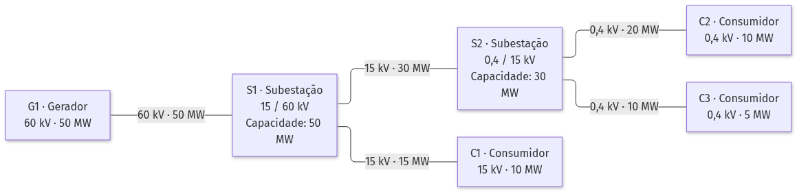
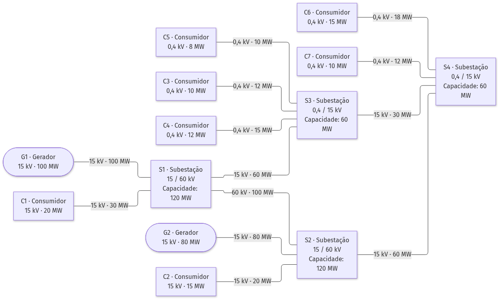

# Projeto TAPOO – Template

Template Maven (JavaFX + [SmartGraph](https://github.com/brunomnsilva/JavaFXSmartGraph) + JUnit) para o projeto de TAPOO.

## Requisitos

- JDK **17 ou superior** (o projeto compila com `release 17`)
- Maven 3.9+ (ou o Maven integrado no IDE)
- JavaFX 21 (descarregado automaticamente pelo Maven)

## Como começar

> [!IMPORTANT]
> É responsabilidade do **leader do grupo** (quem efetuou a inscrição) efetuar os passos 1 e 2.

### 1. Criar o repositório a partir do template

> [!NOTE]
> Os identificadores dos grupos (`<Identificador_Grupo>`) encontram-se publicados no Moodle - na área do projeto - em **Atribuição do Número do Grupo**.

1. Nesta página do template, clicar em **Use this template** → **Create a new repository**.
2. Escolher como *Owner* a conta pessoal do elemento do grupo que está a criar o repositório.
3. Dar ao repositório um nome que identifique o grupo, com o seguinte formato: `ProjetoTAPOO-<Identificador_Grupo>`
   - **Ver identificadores do grupo no Moodle**. Exemplo: `ProjetoTAPOO-PL01_01`
4. Em *Visibility*, escolher **Private**.
5. Clicar em **Create repository**.

> Se o repositório ficou público, ir a **Settings → General → Danger Zone → Change visibility** e alterá-lo para **Private**.

### 2. Adicionar o docente e os colegas de grupo

Só quem tem permissões de administração do repositório (quem o criou) consegue fazer isto:

1. No repositório, abrir **Settings**.
2. No menu lateral, escolher **Collaborators** (em *Access*).
3. Clicar em **Add people**.
4. Pesquisar pelo *username* GitHub (ou e-mail) de cada colega de grupo e do docente e confirmar.
5. Cada pessoa convidada tem de **aceitar o convite** (recebido por e-mail ou em <https://github.com/notifications>).
6. Enviar um email ao docente com o URL do repositório criado.

**Adicionar o docente da vossa turma** como colaborador (pelo *username*):

| Docente | Utilizador GitHub                                                         | Email                            | Turmas        |
|-------|--------------------------------------------|----------------------------------|---------------|
| Bruno Silva | [`brunomnsilva-estsetubal`](https://github.com/brunomnsilva-estsetubal)   | bruno.silva@estsetubal.ips.pt    | PL4, PL5      |
| Patrícia Macedo | [`patriciamacedo`](https://github.com/patriciamacedo)                     | patricia.macedo@estsetubal.ips.pt | PL1, PL3, PL7 |
| Pedro Albuquerque Santos | [`petersaints`](https://github.com/petersaints)                           | pedro.albuquerque@estsetubal.ips.pt | PL2, PL6      |

### 3. Clonar e executar

```bash
git clone <url-do-repositorio>
cd <nome-do-repositorio>
mvn            # compila e executa a aplicação (compile javafx:run)
mvn test       # executa os testes
```

## Estrutura Base

- `src/main/java/pt/unips/tapoo` – código da aplicação (`Main`, `GraphApp`)
- `src/test/java/pt/unips/tapoo` – testes JUnit
- `smartgraph.properties` / `smartgraph.css` – configuração e estilo da visualização do grafo

## Exemplos de redes elétricas

Os diagramas indicam, para cada componente, o identificador, o tipo, a tensão e a potência ou capacidade e, para cada linha, a tensão e a capacidade. Os restantes atributos (nomes, identificadores e comprimentos das linhas e estado operacional) constam das tabelas de cada exemplo. Em ambos os exemplos, **todas as linhas estão ativas**.

### A.1. Rede simples

Exemplifica-se uma rede válida, com 1 gerador, 2 subestações e 3 consumidores:



Este exemplo ilustra:

- **Regras de ligação:** os geradores e consumidores ligam-se a subestações; as subestações podem ligar-se entre si.
- **Compatibilidade de tensão:** S1 permite a transição entre 60 e 15 kV; S2, entre 15 e 0,4 kV.
- **Conectividade:** existe um caminho entre o gerador e cada consumidor através das linhas ativas.

### A.2. Rede complexa

Exemplifica-se uma rede relativamente complexa, mas estruturalmente válida segundo as regras definidas. Inclui 2 geradores, 4 subestações e 7 consumidores, com diferentes níveis de tensão e ligações redundantes entre subestações.




Esta rede é válida porque cumpre as seguintes condições:

- **Topologia:** geradores e consumidores ligam-se apenas a subestações; as subestações podem ligar-se entre si.
- **Tensão:** todas as linhas têm um nível de tensão suportado pelos componentes aos quais estão ligadas.
- **Identificação:** todos os componentes e linhas têm identificadores distintos.
- **Redundância:** existem dois caminhos entre S1 e S4: um através de S3 e outro através de S2.